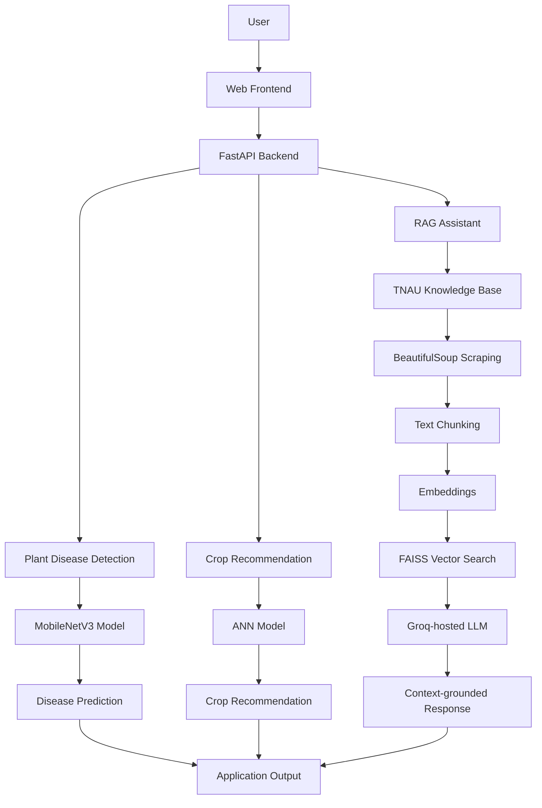

# 🌱 AgroCast AI – Smart Farming Advisory Platform

An AI-powered agricultural advisory platform that integrates **Computer Vision, Machine Learning, and Generative AI** to assist farmers with plant disease identification, crop recommendations, and agricultural knowledge-based query resolution.

AgroCast AI combines three intelligent components into a unified application:

- **Plant Disease Detection:** Identifies plant diseases using a MobileNetV3-based deep learning model.
- **Crop Recommendation:** Recommends suitable crops using an Artificial Neural Network (ANN).
- **AI Farming Assistant:** Uses Retrieval-Augmented Generation (RAG) to provide context-aware agricultural guidance based on information retrieved from a Tamil Nadu Agricultural University (TNAU) knowledge base.

The platform brings predictive intelligence and conversational AI together through a FastAPI backend and web frontend.

---

## 📌 Project Overview

Agricultural decision-making often requires access to reliable information about crop health, suitable crop selection, and farming practices.

AgroCast AI addresses these needs through an integrated AI-driven platform that provides:

1. Image-based plant disease identification.
2. ML-powered crop recommendations.
3. Context-grounded answers to agricultural queries through an LLM-powered assistant.

Rather than relying on a single model, the platform combines multiple AI techniques to address different agricultural problems within one application.

## ✨ Key Features

### 1. 🌿 Plant Disease Detection

- Implements a MobileNetV3-based deep learning model for plant disease classification.
- Uses image-based inference to identify potential plant diseases.
- Achieved **87.8% accuracy** during model evaluation.

### 2. 🌾 Intelligent Crop Recommendation

- Implements an Artificial Neural Network (ANN) for crop recommendation.
- Uses machine learning to generate crop recommendations based on the model's input features.
- Achieved **91.5% accuracy** during model evaluation.

### 3. 🤖 AI-Powered Agricultural Assistant (RAG)

- Provides agricultural query resolution using Retrieval-Augmented Generation.
- Scrapes agricultural information from the Tamil Nadu Agricultural University (TNAU) knowledge base using BeautifulSoup.
- Processes retrieved content through text chunking and embedding generation.
- Uses FAISS for efficient vector similarity search.
- Integrates a Groq-hosted LLM to generate responses grounded in retrieved agricultural information.

### 4. 🔗 Unified AI Application

- Integrates computer vision, predictive machine learning, and RAG-based conversational AI.
- Uses FastAPI as the backend service.
- Provides a web interface to access the different AI capabilities through a unified application.

---

## 🏗️ System Architecture



## 🛠️ Technology Stack

| Category | Technologies |
|---|---|
| Programming Language | Python |
| Deep Learning | TensorFlow / Keras, MobileNetV3 |
| Machine Learning | Artificial Neural Networks (ANN) |
| Generative AI | Large Language Models, Groq API |
| RAG Framework Components | Text Chunking, Embeddings, Retrieval |
| Vector Database | FAISS |
| Web Scraping | BeautifulSoup |
| Backend Development | FastAPI |
| Frontend | Web Application |
| Data Processing | Python |

## 🔍 Implementation Workflow

### 1. Plant Disease Classification

The plant disease detection module uses a MobileNetV3-based deep learning architecture.

**Workflow:**

1. Accept a plant image as input.
2. Apply the required image preprocessing.
3. Pass the processed image to the trained MobileNetV3 model.
4. Generate the predicted disease classification.

**Evaluation Result:**

- Model: MobileNetV3
- Accuracy: 87.8%

### 2. ANN-Based Crop Recommendation

The crop recommendation module uses an Artificial Neural Network to predict suitable crops based on the input features used by the model.

**Workflow:**

1. Receive the required agricultural input features.
2. Prepare the input data for model inference.
3. Pass the processed features through the trained ANN.
4. Generate the recommended crop prediction.

**Evaluation Result:**

- Model: Artificial Neural Network
- Accuracy: 91.5%

### 3. Retrieval-Augmented Generation (RAG) Pipeline

The agricultural assistant uses a retrieval-based architecture to provide responses supported by information from the TNAU knowledge base.

**Step 1 – Knowledge Acquisition**

- Scraped agricultural information from the TNAU knowledge base using BeautifulSoup.
- Extracted relevant textual content for building the retrieval corpus.

**Step 2 – Text Processing**

- Split the extracted content into smaller text chunks.
- Prepared the chunks for embedding generation and retrieval.

**Step 3 – Embedding Generation and Indexing**

- Generated vector embeddings from the processed text.
- Indexed the embeddings using FAISS to support similarity-based retrieval.

**Step 4 – Context Retrieval**

- Converted user queries into embeddings.
- Retrieved relevant knowledge-base chunks through FAISS similarity search.

**Step 5 – LLM Response Generation**

- Integrated a Groq-hosted LLM for response generation.
- Used the retrieved agricultural context to ground the generated responses.
- Returned context-aware answers to user queries.

### 4. Backend Integration

FastAPI acts as the backend layer connecting the application's AI components.

It provides the application interface through which the frontend accesses the plant disease detection, crop recommendation, and RAG assistant capabilities.

---

## 📊 Model Performance

| AI Component | Model / Technique | Accuracy |
|---|---|---:|
| Plant Disease Detection | MobileNetV3 | 87.8% |
| Crop Recommendation | ANN | 91.5% |
| Agricultural Assistant | RAG + Groq LLM | Not reported |

*Note: The accuracy figures represent the reported model evaluation results. They are not production-performance guarantees. RAG response quality was not assigned an accuracy score.*

## 🚀 Getting Started

### Prerequisites

- Python (compatible with the project's dependencies)
- pip
- Git
- Groq API key for the LLM-powered assistant

### Clone the Repository

```bash
git clone https://github.com/tarushivasishth/Agrocast_AI.git

cd Agrocast_AI
```

### Environment Configuration

Configure the required environment variables for the Groq API integration.

For example, create a `.env` file:

```env
GROQ_API_KEY=your_groq_api_key
```

**Security:** Never commit API keys or other credentials to GitHub. Keep `.env` excluded through `.gitignore`.

### Install Dependencies

Install the dependencies specified in the project's requirements file:

```bash
pip install -r requirements.txt
```

*Note: Verify the requirements file and Python version against the actual repository before running the installation command.*

### Run the Application

Start the FastAPI backend using the actual application entry point configured in the repository.

The frontend should be started using its corresponding project-specific run instructions.

---

## 💡 Key Learning Outcomes

Through this project, the following technical concepts were implemented and explored:

- Integrating multiple AI/ML models into a unified application.
- Applying transfer-learning-based computer vision for plant disease classification.
- Building ANN-based predictive models.
- Developing an end-to-end Retrieval-Augmented Generation pipeline.
- Extracting and processing domain-specific knowledge using web scraping.
- Implementing embedding-based semantic retrieval with FAISS.
- Integrating external LLM inference through the Groq API.
- Developing backend services using FastAPI.

## 🔮 Future Enhancements

- Introduce multilingual agricultural assistance.
- Expand the agricultural knowledge base with additional verified sources.
- Evaluate retrieval relevance and response quality using dedicated RAG evaluation metrics.
- Explore more advanced retrieval and reranking techniques.
- Extend the platform with additional agricultural prediction capabilities.
